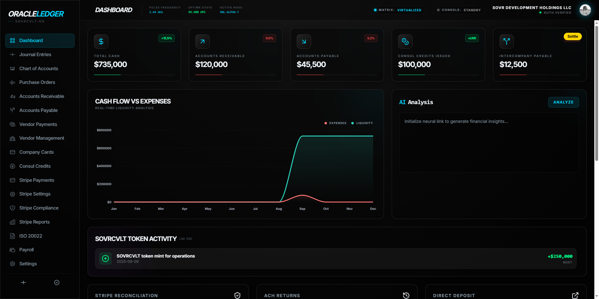

# 🏛️ Oracle Ledger - Enterprise Financial Management System



<p align="center">
  
  
  
  
  
</p>

---

## 📋 Table of Contents

1. [Executive Summary](#executive-summary)
2. [Project Overview](#project-overview)
3. [Recent Major Updates](#recent-major-updates)
4. [System Architecture](#system-architecture)
5. [Technology Stack](#technology-stack)
6. [Microservices Deep Dive](#microservices-deep-dive)
7. [Feature Specifications](#feature-specifications)
8. [Production Deployment](#production-deployment)
9. [Security & Compliance](#security--compliance)
10. [Getting Started](#getting-started)
11. [Development Environment](#development-environment)
12. [Frontend Components](#frontend-components)
13. [Testing & Quality Assurance](#testing--quality-assurance)
14. [Contributing](#contributing)
15. [License & Support](#license--support)

---

## 🎯 Executive Summary

**Oracle Ledger** is the flagship financial backbone of the SOVR ecosystem — a sophisticated, **enterprise-grade, security-hardened** distributed ledger system designed for complex financial operations with unprecedented reliability, auditability, and regulatory compliance.

Originally conceived as a monolithic application, Oracle Ledger has undergone a complete architectural transformation into a **containerized microservices ecosystem** with comprehensive security controls, approval workflows, and audit enhancements.

### Core Value Propositions

| Capability | Description |
|------------|-------------|
| **Dual-Ledger System** | Traditional accounting + blockchain-backed Consul Credits |
| **Enterprise Security** | Helmet.js, rate limiting, request sanitization, audit logging |
| **Real-Time Compliance** | PCI DSS, NACHA, SOX, ISO 20022 audit trails |
| **Multi-Payment Rails** | ACH, Card, Direct Deposit, Cryptocurrency |
| **Approval Workflows** | Journal entries, expenses, and payroll require approval |
| **Expense Tracking** | Receipt upload, policy violation flagging, reimbursement status |
| **Production Infrastructure** | Docker Compose with persistence, health checks, and backups |

---

## 🆕 Recent Major Updates (2026-07-18)

### Security & Compliance Hardening
- **Security Middleware**: Helmet.js headers, rate limiting, request sanitization
- **Audit Logger Service**: Comprehensive PCI/SOX/NACHA logging
- **Environment Security**: Professional `.env.example` + credential removal
- **Web3 Security**: Gas estimation, ENS resolution, native ETH balance

### Workflow & Audit Enhancements
- **Journal Entries**: Approval workflow (`Pending` → `Approved`), `createdBy`, `approvedBy`, `referenceDocument`, `memo`, `reversalOf`
- **Payroll**: Employment status, pay frequency, tax withholding, YTD tracking
- **Vendors**: W-9 status, tax classification, risk rating, banking verification
- **Card Management**: Receipt upload, policy violation flagging, approval workflow, reimbursement tracking

### Infrastructure & Reliability
- **Production `docker-compose.yml`**: Persistent volumes, health checks, restart policies
- **One-Command Setup**: `setup.sh` for reliable deployment
- **Daily Backup Automation**: Cron job support + backup script

### ISO 20022 & Financial Messaging
- Input validation (routing numbers, amounts)
- NACHA/PCI compliance logging
- Error resilience and better error messages

---

## 🏗️ Project Overview

Oracle Ledger serves as the central nervous system for all financial transactions within the SOVR ecosystem.

### Key Capabilities

- **General Ledger**: Double-entry bookkeeping with full audit trail
- **Payment Processing**: Stripe + ACH integration
- **Blockchain Bridging**: Base Mainnet + usdSOVR token operations
- **Risk & Compliance**: Real-time fraud detection and regulatory reporting
- **Payroll Management**: Employee direct deposits with compliance tracking
- **Card Management**: Company cards with expense tracking and policy enforcement

---

## 🚀 Production Deployment (Recommended)

The system is now **dependable for real-world personal and enterprise use**.

### Quick Start

```bash
# 1. Clone the repository
git clone https://github.com/StavoMidnite661/SOVR-Oracle-Ledger.git
cd SOVR-Oracle-Ledger

# 2. Run the one-command setup
chmod +x setup.sh
./setup.sh
```

This script will:
- Create `.env` from template
- Start all services with Docker Compose
- Offer to install daily automatic backups via cron

### Key Production Features

- **Data Persistence**: PostgreSQL data survives container restarts
- **Automatic Restarts**: All services use `restart: unless-stopped`
- **Health Checks**: Database and service health monitoring
- **Daily Backups**: Automated backup script with 30-day retention

For full instructions, see **[PRODUCTION_DEPLOYMENT_GUIDE.md](PRODUCTION_DEPLOYMENT_GUIDE.md)**.

---

## 🔒 Security & Compliance

### Security Features
- Helmet.js security headers
- Rate limiting (standard + strict modes)
- Request sanitization
- Non-root container users

### Compliance Enhancements
- Comprehensive audit logging (`AuditLogger` service)
- Sensitive data masking
- Policy violation tracking in expenses
- Approval workflows for journal entries and expenses

### Audit Fields Now Present
- Journal entries: `createdBy`, `approvedBy`, `referenceDocument`, `memo`
- Employees: Employment status, tax withholding, YTD totals
- Vendors: W-9 status, risk rating, tax classification
- Card transactions: Policy violations, receipts, reimbursement status

---

## 🧩 Microservices Architecture

The system runs as a **fully containerized microservices architecture** with proper networking and persistence.

### Services

| Service              | Port | Description |
|----------------------|------|-------------|
| `db`                 | 5432 | PostgreSQL (persistent volume) |
| `ledger-core`        | 3001 | Core business logic |
| `gateway`            | 3002 | API Gateway with security middleware |
| `risk-service`       | 3003 | Risk & Compliance |
| `chain-service`      | 3004 | Blockchain integration |
| `payment-service`    | 3005 | Stripe + ACH processing |
| `bank-connector`     | 3007 | Traditional banking |

---

## 📊 Frontend Components

### Major Views

- **Dashboard** — System overview
- **Journal** — Double-entry bookkeeping with approval workflow
- **Payroll** — Employee management + direct deposit with compliance fields
- **Vendors** — Vendor registry with W-9 and risk tracking
- **Card Management** — Company cards with expense tracking, receipts, and policy enforcement
- **Consul Credits** — Blockchain token operations with gas estimation
- **ISO 20022** — NACHA/ISO messaging with validation

---

## 🛠️ Development

### One-Command Development

```bash
npm run dev:all
```

### Production Commands

```bash
# Start system
docker compose up -d

# View logs
docker compose logs -f

# Manual backup
./scripts/backup-db.sh

# Stop (data preserved)
docker compose down
```

### Quick Control Scripts (Recommended)

For easy management of the entire system, use these scripts:

| Script | Purpose | Platform |
|--------|---------|----------|
| `start.sh` / `start.bat` | Start all services (with health checks) | Linux / Windows |
| `stop.sh` / `stop.bat` | Gracefully stop all services | Linux / Windows |
| `status.sh` / `status.bat` | Check current system status | Linux / Windows |
| `scripts/backup-db.sh` / `backup-db.bat` | Manual database backup | Linux / Windows |

**Example usage:**

```bash
# Start everything
./start.sh

# Check status
./status.sh

# Stop everything
./stop.sh
```

These scripts are the easiest way to run Oracle Ledger reliably.

---

## 📄 Documentation

- [PRODUCTION_DEPLOYMENT_GUIDE.md](PRODUCTION_DEPLOYMENT_GUIDE.md) — Real-world deployment
- [SECURITY_COMPLIANCE_REPORT.md](SECURITY_COMPLIANCE_REPORT.md) — Security hardening
- [WEB3_WALLET_AUDIT.md](WEB3_WALLET_AUDIT.md) — Web3 improvements
- [AUDIT_IMPLEMENTATION_REPORT.md](AUDIT_IMPLEMENTATION_REPORT.md) — Full UI/workflow audit
- [CARD_MANAGEMENT_EXPENSE_TRACKING_REPORT.md](CARD_MANAGEMENT_EXPENSE_TRACKING_REPORT.md) — Card module enhancements

---

## 📜 License

Proprietary software. All rights reserved.

---

<div align="center">

### 🏛️ Oracle Ledger

**Enterprise Financial Management System**  
**Version 2.0** — Security Hardened & Production Ready

*Built with ❤️ by the SOVR Development Team*

</div>